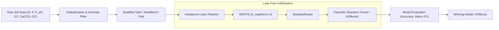

# 🌾 Soil Nutrient & Biochemical Profiling for Crop Recommendation

[](https://www.python.org/)
[](https://jupyter.org/)
[](https://scikit-learn.org/)
[](https://xgboost.readthedocs.io/)
[](https://imbalanced-learn.org/)
[](https://opensource.org/licenses/MIT)

> **Sprint 02 — Nolyth AI Machine Learning & Data Science Project**  
> An end-to-end Machine Learning pipeline utilizing soil chemical properties and macronutrient (NPK) profiling to recommend optimal crop varieties for agricultural productivity in the Nashik region.

---

## 📌 Table of Contents

- [Overview & Objectives](#-overview--objectives)
- [Dataset Architecture](#-dataset-architecture)
  - [Feature Dictionary](#feature-dictionary)
  - [Crop Class Distribution & Target Imbalance](#crop-class-distribution--target-imbalance)
- [Data Cleaning & Anomaly Detection](#-data-cleaning--anomaly-detection)
- [Exploratory Data Analysis (EDA)](#-exploratory-data-analysis-eda)
  - [Univariate Analysis](#1-univariate-analysis)
  - [Bivariate Analysis](#2-bivariate-analysis)
  - [Multivariate Analysis & Correlation Heatmap](#3-multivariate-analysis--correlation-heatmap)
- [Machine Learning Workflow](#-machine-learning-workflow)
  - [Leak-Free Pipeline Architecture](#leak-free-pipeline-architecture)
  - [SMOTE Configuration](#smote-configuration)
  - [Candidate Models](#candidate-models)
- [Evaluation & Performance Benchmarks](#-evaluation--performance-benchmarks)
  - [Hold-Out Test Set (80/20 Stratified Split)](#hold-out-test-set-8020-stratified-split)
  - [5-Fold Stratified Cross-Validation](#5-fold-stratified-cross-validation)
  - [Winning Model Classification Report](#winning-model-classification-report)
- [Key Limitations & Botanical Insights](#-key-limitations--botanical-insights)
- [Model Deployment & Inference](#-model-deployment--inference)
- [Project Structure](#-project-structure)
- [Installation & How to Run](#-installation--how-to-run)
- [License & Acknowledgments](#-license--acknowledgments)

---

## 📖 Overview & Objectives

In modern precision agriculture, choosing the right crop for specific soil conditions is critical for maximizing yield, reducing fertilizer overuse, preserving soil biodiversity, and increasing farmer profitability. 

This project develops a predictive modeling framework that analyzes:
1. **Soil Physical & Chemical Properties**: pH, Electrical Conductivity (EC), Calcium Carbonate ($CaCO_3$), and Organic Carbon (OC).
2. **Macronutrient Concentrations**: Nitrogen ($N$), Phosphorus ($P$), and Potassium ($K$).

Based on these 7 parameters, the model recommends the most suitable crop out of **15 distinct agricultural crops** cultivated in the Nashik region.

---

## 📊 Dataset Architecture

The project leverages the **Crop Prediction Dataset for the Nashik Region** collected by Damini Jadhav (available on Kaggle).

### Feature Dictionary

| Feature | Type | Unit | Description & Agronomic Relevance |
| :--- | :---: | :---: | :--- |
| `ph` | Numerical | scale $0-14$ | Measure of soil acidity or alkalinity. Affects nutrient bioavailability. |
| `EC` | Numerical | $\text{dS/m}$ | Electrical Conductivity; indicates soluble salt concentration (salinity). |
| `CaCO3` | Numerical | $\%$ | Calcium Carbonate content (soil liming indicator). |
| `OC` | Numerical | $\%$ | Soil Organic Carbon; critical benchmark of soil fertility and microbial health. |
| `N` | Numerical | $\text{kg/ha}$ | Available Nitrogen; essential for vegetative growth and leaf greenness. |
| `P` | Numerical | $\text{kg/ha}$ | Available Phosphorus; stimulates root growth, flowering, and seed formation. |
| `K` | Numerical | $\text{kg/ha}$ | Available Potassium; regulates water balance, osmotic pressure, and disease resistance. |
| **`label`** | Categorical | — | **Target variable**: The recommended crop (15 classes). |

### Crop Class Distribution & Target Imbalance

After deduplication and cleaning, the dataset comprises **1,158 soil samples** spanning 15 crops with significant class imbalance:

| Crop Class | Sample Count | Percentage | Imbalance Status |
| :--- | :---: | :---: | :--- |
| **Grapes** | 116 | $10.02\%$ | Majority class |
| **Cabbage** | 101 | $8.72\%$ | Majority class |
| **Bajra** (Pearl Millet) | 101 | $8.72\%$ | Majority class |
| **Maize** | 101 | $8.72\%$ | Majority class |
| **Jowar** (Sorghum) | 101 | $8.72\%$ | Majority class |
| **Sugarcane** | 101 | $8.72\%$ | Majority class |
| **Wheat** | 101 | $8.72\%$ | Majority class |
| **Pomegranate** | 100 | $8.64\%$ | Majority class |
| **Cotton** | 84 | $7.25\%$ | Moderate |
| **Soybean** | 82 | $7.08\%$ | Moderate |
| **Tomato** | 55 | $4.75\%$ | Minority |
| **Rice** | 51 | $4.40\%$ | Minority |
| **Onion** | 34 | $2.94\%$ | Severe Minority |
| **Potato** | 24 | $2.07\%$ | Severe Minority |
| **Cauliflower** | 6 | $0.52\%$ | **Extreme Minority (Support = 6)** |

---

## 🧹 Data Cleaning & Anomaly Detection

1. **Duplicate Elimination**:
   - Initial row count: `1,239` samples.
   - Exact duplicate records detected: `80` rows.
   - Dropped to prevent optimistic evaluation and train-test contamination (`1,159` rows remaining).

2. **Biological Anomaly & Impossible pH Filtering**:
   - Summary statistics revealed an extreme recorded value of `ph = 598.0`.
   - On the international chemical pH scale ($0.0 - 14.0$), values $> 14$ are scientifically impossible.
   - Filtered with `df[(df['ph'] >= 0) & (df['ph'] <= 14)]`, removing 1 erroneous record (`1,158` clean samples remaining).

3. **High Variance & Outlier Inspection**:
   - Potassium ($K$) exhibited extreme standard deviation ($\sigma = 149.76$, range $35.0 - 1,170.35$).
   - Phosphorus ($P$) showed notable dispersion ($\sigma = 21.11$, range $1.03 - 85.0$).
   - Robust scaling (`StandardScaler`) was introduced inside the pipeline to standardize feature scales without skewing tree-based or distance-sensitive boundaries.

---

## 🔍 Exploratory Data Analysis (EDA)

### 1. Univariate Analysis
- **Histograms & KDE Distributions**: Soil parameters (`ph`, `EC`, `CaCO3`, `OC`, `N`, `P`, `K`) were plotted with kernel density estimates.
- **Boxplot Profiling**: Highlighted high dispersion in macronutrients ($K$ and $P$) and right-skewness in Organic Carbon ($OC$).

### 2. Bivariate Analysis
- **Crop-wise Boxplots for Macronutrients ($N, P, K$)**:
  - Grapes and Sugarcane thrive in high Potassium ($K$) environments.
  - Cereal crops like Wheat, Jowar, and Bajra occupy distinct Nitrogen-Phosphorus clusters.
  - Clear **class separability** is observable across nutrient dimensions, confirming strong discriminative power.
- **Crop-wise Boxplots for Soil Properties ($pH, EC, CaCO_3, OC$)**:
  - Rice and Grapes demand specific pH and salinity envelopes.
  - Clear non-overlapping quartiles for most crops, empowering tree-based estimators to find clean decision boundaries.

### 3. Multivariate Analysis & Correlation Heatmap
- Computed Pearson correlation matrix across all 7 numerical features:
  - Strong positive correlation between **$K$ (Potassium) and $N$ (Nitrogen)**: $r = +0.63$.
  - Strong negative correlation between **$K$ (Potassium) and $P$ (Phosphorus)**: $r = -0.62$.
  - **Absence of Multicollinearity**: No feature pair exhibited correlation $|r| > 0.85$.
  - **Conclusion**: Retained all original features without requiring Dimensionality Reduction (PCA) or feature pruning.

---

## ⚙️ Machine Learning Workflow



### Leak-Free Pipeline Architecture
To eliminate data leakage, data transformations such as synthetic oversampling and scaling **must never be applied to validation or test data**.  
We employed `imblearn.pipeline.Pipeline`, ensuring:
- `SMOTE` oversamples **only** the training fold.
- `StandardScaler` calculates mean and standard deviation **only** on the training fold and applies the learned transformation to validation/test folds.

### SMOTE Configuration
Due to the extreme minority class (`cauliflower` with only 6 instances), standard default `k_neighbors=5` in SMOTE fails during train splits ($N_{train} = 5$).  
We configured:
```python
SMOTE(random_state=42, k_neighbors=3)
```
This enables synthetic interpolation without crashing on severely underrepresented classes.

### Candidate Models
1. **Random Forest Classifier**:
   - `n_estimators=100`, `random_state=42`
2. **XGBoost Classifier**:
   - `n_estimators=100`, `eval_metric='mlogloss'`, `random_state=42`

---

## 📈 Evaluation & Performance Benchmarks

### Hold-Out Test Set (80/20 Stratified Split)

Evaluated on 232 test samples:

| Model Pipeline | Holdout Test Accuracy | Macro Avg F1-Score | Weighted Avg F1-Score |
| :--- | :---: | :---: | :---: |
| **Random Forest Pipeline** | $93.97\%$ | $0.86$ | $0.94$ |
| **XGBoost Pipeline** | **$94.40\%$** | **$0.87$** | **$0.94$** |

### 5-Fold Stratified Cross-Validation
To obtain unbiased, statistically rigorous performance estimates across all minority classes, **5-Fold Stratified Cross-Validation** was executed using Macro F1-score (`scoring='f1_macro'`):

| Model | 5-Fold Macro F1 (Mean) | Standard Deviation ($\sigma$) | Verdict |
| :--- | :---: | :---: | :--- |
| **Random Forest** | $88.20\%$ | $\pm 3.21\%$ | Solid performance |
| **XGBoost** | **$88.21\%$** | **$\pm 2.03\%$** | **Selected Winner (Lower variance & higher stability)** |

---

### Winning Model Classification Report

**XGBoost 5-Fold Cross-Validated Out-of-Fold Predictions ($N = 1,158$):**
- **Overall CV Accuracy**: **$96.03\%$**
- **Macro Average F1**: **$88.00\%$**
- **Weighted Average F1**: **$96.00\%$**

```
=======================================================
Detailed CV Classification Report (XGBoost):
-------------------------------------------------------
              precision    recall  f1-score   support

       bajra       1.00      1.00      1.00       101
     cabbage       1.00      1.00      1.00       101
 cauliflower       0.00      0.00      0.00         6
      cotton       1.00      1.00      1.00        84
      grapes       0.93      0.90      0.91       116
       jowar       0.97      1.00      0.99       101
       maize       1.00      1.00      1.00       101
       onion       0.72      0.68      0.70        34
 pomegranate       1.00      1.00      1.00       100
      potato       0.96      1.00      0.98        24
        rice       0.98      0.92      0.95        51
     soybean       0.92      0.95      0.93        82
   sugarcane       1.00      1.00      1.00       101
      tomato       0.81      0.80      0.81        55
       wheat       0.96      0.99      0.98       101

    accuracy                           0.96      1158
   macro avg       0.88      0.88      0.88      1158
weighted avg       0.96      0.96      0.96      1158
=======================================================
```

---

## 🔬 Key Limitations & Botanical Insights

### The Cauliflower Anomaly (0% F1-Score Explained)
Despite applying SMOTE with `k_neighbors=3`, **Cauliflower** achieved a $0\%$ F1-score across both Random Forest and XGBoost.

#### Root Causes:
1. **Severe Support Deficit**: Cauliflower accounts for only **6 samples ($0.52\%$)** in the entire dataset.
2. **Biochemical Feature Overlap**: Botanical profiling reveals that *Brassica oleracea var. botrytis* (Cauliflower) and *Brassica oleracea var. capitata* (Cabbage) share virtually identical soil chemistry, pH thresholds, and NPK requirements.
3. **Statistical Dominance**: With Cabbage having 101 samples and identical chemical signatures, the decision tree boundaries statistically absorb Cauliflower instances into the Cabbage class.

#### Professional Recommendations:
- **Agronomic Re-sampling**: Collect at least 50–100 distinct field soil samples specifically from Cauliflower plots.
- **Hierarchical Taxonomic Grouping**: Group genetically closely related cruciferous brassicas (`Brassica Family`) into a common tier before fine-grained secondary classification.
- **Exclude / Quarantine Minority Noise**: If sample collection is unfeasible, dropping Cauliflower eliminates artificial skew in Macro F1 scores.

---

## 🚀 Model Deployment & Inference

The final winning model was trained on 100% of the clean dataset and serialized using `joblib` into `s2_npk_xgboost_pipeline.pkl`.

### Running Predictions

```python
import pandas as pd
import joblib

# Load trained pipeline and label encoder
pipeline = joblib.load('s2_npk_xgboost_pipeline.pkl')
le = joblib.load('label_encoder.pkl')

def recommend_crop(ph, ec, caco3, oc, n, p, k):
    """
    Predict optimal crop given soil chemistry parameters.
    """
    input_df = pd.DataFrame([{
        'ph': ph,
        'EC': ec,
        'CaCO3': caco3,
        'OC': oc,
        'N': n,
        'P': p,
        'K': k
    }])
    
    encoded_pred = pipeline.predict(input_df)
    recommended_crop = le.inverse_transform(encoded_pred)[0]
    return recommended_crop

# Example Demonstration:
sample_prediction = recommend_crop(
    ph=5.0, ec=1.0, caco3=3.0, oc=1.0, n=130, p=110, k=150
)
print(f"Recommended Crop: {sample_prediction.upper()}")
# Output: RECOMMENDED CROP: SUGARCANE
```

---

## 📁 Project Structure

```text
├── s2-npk-project.ipynb           # Complete Jupyter Notebook (EDA, Modeling, CV, Inference)
├── s2_npk_xgboost_pipeline.pkl    # Serialized end-to-end SMOTE + Scaler + XGBoost Pipeline
├── label_encoder.pkl             # Target LabelEncoder for crop class mapping
├── requirements.txt               # Python package dependencies
├── .gitignore                     # Git ignore rules for clean repository state
└── README.md                      # Comprehensive project documentation
```

---

## 🛠️ Installation & How to Run

### 1. Clone the Repository
```bash
git clone https://github.com/ARKhalid123/Sprint_02_Nolyth.git
cd Sprint_02_Nolyth
```

### 2. Set Up a Virtual Environment
```bash
# Windows
python -m venv venv
venv\Scripts\activate

# Linux / macOS
python3 -m venv venv
source venv/bin/activate
```

### 3. Install Dependencies
```bash
pip install -r requirements.txt
```

### 4. Launch Jupyter Notebook
```bash
jupyter notebook s2-npk-project.ipynb
```

---

## 📜 License & Acknowledgments

- **Dataset**: Provided by Damini Jadhav on [Kaggle](https://www.kaggle.com/datasets/daminijadhav2003/crop-predication-dataset-based-on-nashik-region).
- **Author**: [Abdul Rehman Khalid](https://github.com/ARKhalid123)
- **Program**: Nolyth AI — Sprint 02 (Data Analysis & Machine Learning).
- **License**: Released under the [MIT License](LICENSE).
